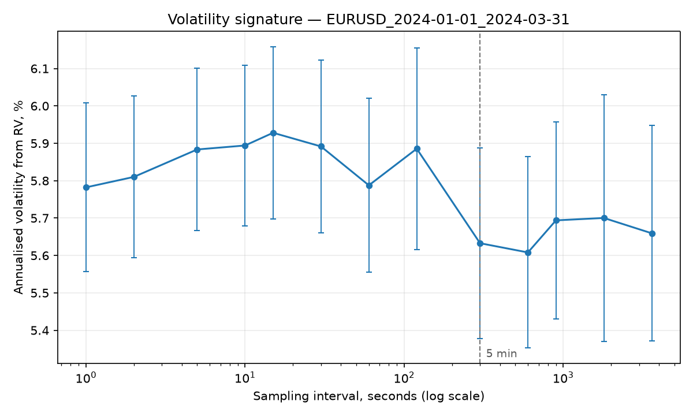
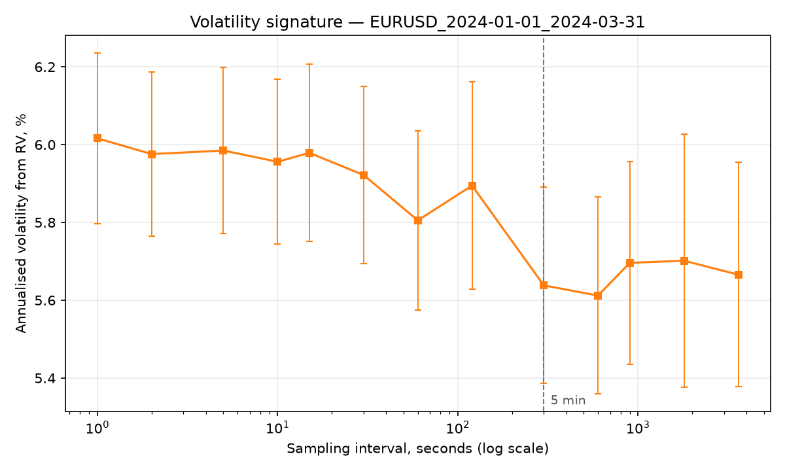
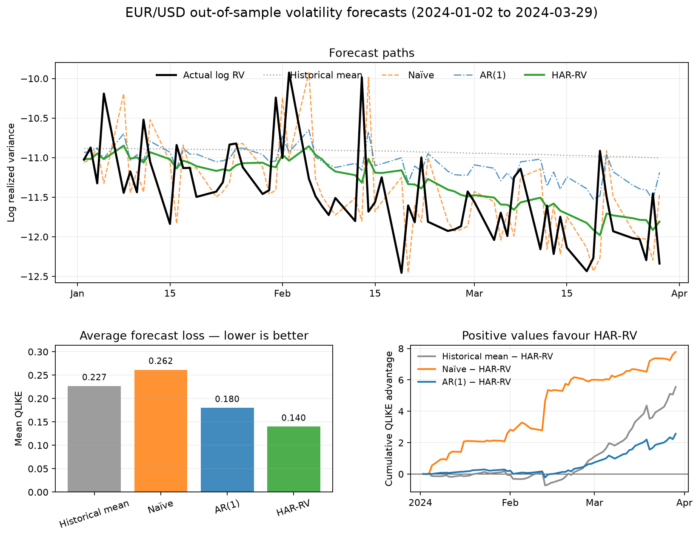

# Realized Volatility

Estimating realized volatility from intraday data, forecasting it, and comparing
the forecasts with proper statistical tests.

## Question

How predictable is daily volatility, and can competing models be told apart
statistically — given that the target itself is unobservable and is estimated
with error?

## Architecture

    src/rvol/domain/       immutable configuration, results, and protocols
    src/rvol/application/  model-agnostic walk-forward use cases
    src/rvol/cli/          packaged command-line entry points
    src/rvol/composition/  experiment components and comparison defaults
    src/rvol/models/       interchangeable volatility forecasting models
    src/rvol/evaluation/   loss metrics and statistical model comparison
    src/rvol/reporting/    deterministic experiment artifacts
    src/rvol/infrastructure/ Parquet persistence adapters
    src/rvol/data/         external data download and parsing
    src/rvol/market/       FX sessions and timestamp sampling rules
    src/rvol/estimators/   pure numerical variance estimators
    src/rvol/features/     daily features built from market data and estimators
    src/rvol/diagnostics/  volatility signatures and microstructure tests
    src/rvol/plotting/     static research figures
    src/rvol/simulation/   latent prices, observation noise, Monte Carlo checks
    scripts/               thin command-line and reproducibility entry points
    tests/                 checks against synthetic data with a known answer

Additional noise- and jump-robust estimators are not yet implemented.

The forecasting dependency direction points toward stable contracts:

    cli (scripts delegate here)
       ├── composition ─┬──> application ──> domain
       │               ├──> models ────────> domain
       │               ├──> features ──────> domain
       │               └──> evaluation ──> domain
       ├── evaluation ────────────────> domain
       ├── reporting ──> evaluation + domain
       └── infrastructure

Installed environments also expose `rvol-evaluate-forecasts`,
`rvol-forecast-plots`, and `rvol-robustness-report`. The corresponding files
under `scripts/` remain as compatibility wrappers.

The independent data-preparation pipeline is:

    data + market + estimators ──> features ──> composition

`estimators` contains no pandas, timestamps, FX conventions, or reporting.
`market` contains no variance formulas. `features` is the adapter that combines
the two, while higher layers consume the resulting daily quantities. Forecast
models implement the domain `Forecaster` protocol, and Parquet persistence
implements `DatasetRepository`; neither is hard-coded into the experiment.

To add a model, implement `name`, `feature_names`, `specification`, and `fit`,
then inject the new object into `WalkForwardExperiment`. The experiment and
evaluator do not need model-specific branches. Tests enforce the dependency
direction so an inner layer cannot accidentally import an outer adapter.

All models share one array-based interface: `fit(features, target)` returns a
fitted object with `predict(features)`. Features are two-dimensional arrays
with columns in `model.feature_names` order; training targets are
one-dimensional arrays of observed log realised variance. Both operations
leave their inputs unchanged. Predictions are one-dimensional arrays with one
finite log variance per row, representing finite positive variances after
exponentiation.

The HAR-specific `fit_har` function and `HarModel` DataFrame wrapper have been
removed. Convert DataFrames to arrays at the call site and use the common API:

    from rvol.models import HARForecaster

    model = HARForecaster()
    columns = list(model.feature_names)
    fitted = model.fit(
        training.loc[:, columns].to_numpy(dtype="float64"),
        training["target"].to_numpy(dtype="float64"),
    )
    predicted_log_rv = fitted.predict(current.loc[:, columns].to_numpy(dtype="float64"))

Fitted coefficients are available as `fitted.intercept` and
`fitted.coefficients`, with slopes in `model.feature_names` order.

The standard commands share an `ExperimentDefinition` from
`rvol.composition.standard_experiment_definition`. It selects the feature
builder, models, executor factory, metrics, evaluation comparison pairs, plot
candidate, and robustness baselines together. Construct a different definition
to use other features, models, execution methods, metrics, or comparison choices:

    from rvol.composition import standard_experiment_definition
    from rvol.domain import ExperimentConfig, WalkForwardSettings

    definition = standard_experiment_definition()
    config = ExperimentConfig(execution=WalkForwardSettings(min_train_size=252))
    experiment = definition.run(daily, config)
    evaluation = definition.evaluator().evaluate(experiment)

`ExperimentExecutor[Dataset]` is the execution contract: `run(features)` returns
an `ExperimentResult`. `ExperimentDefinition` receives an `executor_factory`
that accepts `(models, config)` and creates a fresh executor for each call to
`definition.run`. The definition prepares features and delegates execution;
the executor owns fitting, observation availability and forecasting. Executors
preserve the prepared input and keep fitted state local to each run.

The standard factory is `WalkForwardExperiment`. Select another implementation
through the same composition entry point:

    definition = standard_experiment_definition(executor_factory=CustomExecutor)

`CustomExecutor(models, config)` must implement `run(features)`. Independently
constructed `ExperimentDefinition` objects also require an `executor_factory`.
Executors return the common forecast records so evaluation and plotting can be
reused; artifact export additionally requires the run configuration, execution
snapshot and fit boundaries described below. Executors can use independent
settings types. Schemes requiring fold identifiers need corresponding result
extensions.

`ExperimentConfig[Settings]` contains shared reporting dates and a required
`execution` settings object. `ExperimentDefinition[Settings]` binds its executor
factory to that settings type. Each execution method validates its own settings;
the shared configuration does not impose training windows or refitting rules.
`ExperimentRun(definition, config)` binds a compatible definition and settings
for repeated calls to `run.run(daily)`. The commands use this same object when
selecting an executor.
`holdout_experiment_definition()` assembles the standard models and features
with holdout execution; composition owns concrete executor selection.

Evaluation keeps the default naive-versus-HAR comparison and accepts ordered
`--compare` overrides. Plots compare all other models with the configured
candidate. Robustness uses the definition's ordered baseline list, with the
requested HAC lags and top-error count. The existing
`run_standard_forecast_experiment` helper delegates to the same definition.

Direct `ForecastEvaluator` calls calculate loss summaries without implicit
model comparisons; pass `comparison_pairs` explicitly when needed. Direct
`ForecastRobustnessAnalyzer` and `plot_forecast_evaluation` calls require their
candidate (and robustness baselines) explicitly. These numerical and plotting
components do not select the project's model names.

Models and feature builders expose an immutable `ComponentSpecification` with
an implementation identifier, ordered feature names and scalar settings.
`Forecaster.specification` is part of the model contract;
`FeatureBuilder[pd.DataFrame]` describes a callable with the same property.
`HARFeatureBuilder` binds its column names, rolling windows and gap policy to
both feature preparation and metadata. The `build_har_features` function
remains available with the same defaults and arguments.

Use `definition.specification` to snapshot the selected feature builder and
models before running an experiment. Custom components describe their own
settings; reporting depends on these domain values rather than importing
concrete models or duplicating their defaults. Direct `ForecastArtifactWriter`
calls now require this snapshot as the `specification` keyword argument.

Execution policies select the strategy used by a walk-forward run:

    from rvol.composition import standard_experiment_definition
    from rvol.domain import EveryNSessions, ExperimentConfig, RollingWindow, WalkForwardSettings

    settings = WalkForwardSettings(
        training_window=RollingWindow(size=504),
        retrain=EveryNSessions(5),
        min_train_size=252,
    )
    config = ExperimentConfig(execution=settings)
    definition = standard_experiment_definition()
    experiment = definition.run(daily, config)

`TrainingWindowPolicy.select(n_available)` returns a slice of chronological,
already eligible training rows. `ExpandingWindow` selects all of them;
`RollingWindow` selects up to its configured size. Sizes count observations.
`RefitSchedule.should_refit(eligible_origin_index)` counts forecast origins
starting at zero for the first origin meeting the training requirement.
`EveryNSessions(5)` is due at indices 0, 5, 10, and so on, using indices from
the full dataset even when only a later date range is reported. Calendar gaps
do not advance the count. `WalkForwardSettings()` defaults to expanding
history and refitting every session.

Fitted models may additionally implement `UpdatablePredictor`. Its
`update(features, target)` method consumes new observations in chronological
order and returns updated state, preserving its parameters, the previous
predictor and the input arrays. Targets are observed log realized variances;
the caller ensures availability and supplies each observation once. Empty
batches preserve the state. EWMA implements this capability with the same
variance-scale recursion used by `fit`; other fitted models retain the common
`predict` interface. Fitting EWMA again initializes its state from the supplied
training window.

The runner starts once the selected window meets `min_train_size`, growing a
rolling window up to its configured size. Set the minimum equal to the window
size to require a full window from the first fit. A bounded window must be at
least the minimum training size. Without a strategy override, runs retain
expanding history and daily refitting.

Between refits, HAR and AR1 reuse their fitted coefficients with fresh features,
and HAR retains its fitted smearing correction. EWMA consumes only newly
available targets, once each; a refit rebuilds its state from the selected
window. Both fitting and updates use outcomes with `target_date <= origin_date`.
Reporting bounds preserve the global schedule: the runner initializes from
the last scheduled fit before the requested range and applies subsequent
updates before reporting its first forecast. All fitted state belongs to one
run. Origin dates must advance strictly in chronological order.

Forecast records carry `fit_date`, `train_start_date`, and `train_end_date`.
Training boundaries refer to target dates in the last fit, and `n_train` is
the count used by that fit, including when the model is reused or updated.
`ExperimentResult` also retains the run configuration and immutable `execution`
metadata. `ExecutionMetadata` records the actual executor implementation, an
`ExecutionSpecification` snapshot and scalar runtime `facts`. Settings describe
their own component and any named policies. Walk-forward supplies its schedule
anchor and observation-update rule as runtime facts; the artifact writer adds
no execution rules. Custom settings implement `DescribedExecutionSettings` for
export, and custom window and refit policies provide component specifications.

Chronological holdout uses a separate executor and settings type:

    from datetime import date
    from rvol.application import HoldoutExperiment
    from rvol.composition import standard_experiment_definition
    from rvol.domain import ExperimentConfig, HoldoutSettings

    definition = standard_experiment_definition(executor_factory=HoldoutExperiment)
    config = ExperimentConfig(
        execution=HoldoutSettings(
            train_end=date(2024, 12, 31),
            min_train_size=252,
            update_observations=False,
        ),
        forecast_start=date(2025, 1, 1),
    )
    experiment = definition.run(daily, config)
    evaluation = definition.evaluator().evaluate(experiment)

Holdout fits once using every prepared row whose target date is on or before
`train_end`, and requires the minimum training count at that cutoff. Forecast
origins must be on or after the cutoff; targets must follow it. A nontrading
cutoff is allowed. Every forecast uses fresh input features with fixed fitted
parameters. By default, predictor state is also fixed. Set
`update_observations=True` to let stateful predictors consume newly available
outcomes, once each, at subsequent origins. EWMA then updates its variance
state; models without an update method keep their fitted predictors.

Reporting dates do not change fitting or the observations available at an
origin. `fit_date` remains the configured cutoff, and `n_train` and training
boundaries describe the single fit. Holdout uses the same evaluator, plotting
and artifact writer as walk-forward. Its metadata records the cutoff and update
rule, without a walk-forward schedule anchor.

The evaluation, forecast-plot and robustness commands share these options,
including their installed `rvol-*` equivalents:

| Option | Meaning | Default |
|---|---|---|
| `--executor walk-forward` or `holdout` | Execution method | `walk-forward` |
| `--min-train-size N` | Minimum training observations | Selected executor's default (`252` for both) |
| `--training-window expanding` or `rolling` | History selected at each fit | `expanding` |
| `--window-size N` | Maximum training observations for a rolling window | Required for `rolling` |
| `--retrain-every N` | Refit every N eligible forecast sessions | `1` |
| `--train-end YYYY-MM-DD` | Holdout training cutoff | Required for `holdout` |
| `--update-observations` | Update stateful holdout predictors with available outcomes | Disabled |

For example, use up to 504 training observations and refit every fifth eligible
session with:

    python scripts/evaluate_forecasts.py \
        data/derived/EURUSD_daily_rv_5min.parquet \
        --min-train-size 252 \
        --training-window rolling \
        --window-size 504 \
        --retrain-every 5 \
        --forecast-start 2025-01-01 \
        --forecast-end 2026-09-30 \
        --output-dir outputs/rolling_504_refit_5

Pass the same training and date options to `scripts/forecast_plots.py` or
`scripts/robustness_report.py` to use the same forecasts in their outputs.
`--window-size` requires `--training-window rolling` and must be at least
`--min-train-size`. Counts and intervals must be positive integers. Invalid
options and reversed date bounds produce usage errors before loading the data.
Omitting the new options preserves expanding history and daily refitting.

Run chronological holdout with a fixed training cutoff:

    python scripts/evaluate_forecasts.py \
        data/derived/EURUSD_daily_rv_5min.parquet \
        --executor holdout \
        --train-end 2024-12-31 \
        --min-train-size 252 \
        --forecast-start 2025-01-01 \
        --forecast-end 2026-09-30 \
        --output-dir outputs/holdout_2024

Add `--update-observations` to update EWMA state after the cutoff. Pass the same
executor and date options to the plot and robustness commands. Holdout rejects
`--training-window`, `--window-size` and `--retrain-every`, including explicitly
supplied default values. Walk-forward rejects `--train-end` and
`--update-observations`. Invalid combinations fail before data loading.

## Reproduce the plots

    python scripts/sampling_plot.py
    python scripts/returns_and_rv_plot.py
    python scripts/cumulative_iv_vs_rv_plot.py
    python scripts/bid_ask_bounce_plot.py
    python scripts/daily_rv_plot.py
    python scripts/heston_plot.py
    python scripts/simulation_plots.py
    python scripts/forecast_plots.py \
        data/derived/EURUSD_daily_rv_5min.parquet \
        --min-train-size 200 \
        --forecast-start 2024-01-01 \
        --forecast-end 2024-03-31
    python scripts/diagnostics_plots.py \
        data/EURUSD_2024-01-01_2024-03-31.parquet

The scripts write `figures/sampling_grids.png`, `figures/returns_and_rv.png`,
`figures/cumulative_iv_vs_rv.png`, `figures/bid_ask_bounce.png`,
`figures/daily_rv.png`, `figures/heston_simulation.png`,
`figures/simulation_overview.png`, `figures/forecast_evaluation.png`, and
`figures/diagnostics_overview.png`.
Use `scripts/signature_plot.py` when only one mid, bid, or ask signature is
needed.

## Build the daily dataset

Keep downloaded tick data in separate chunks, then combine them into a compact
daily realised-variance dataset without loading every chunk at once:

    python scripts/build_daily_dataset.py "data/EURUSD_*.parquet" \
        --frequency 5min \
        --out data/derived/EURUSD_daily_rv_5min.parquet

The builder carries FX sessions across file boundaries, removes overlapping
timestamps and session dates, and writes the output atomically. The result has
one row per complete session with the session date, realised variance, log
realised variance, and the number of sampled observations.

Audit coverage before forecasting:

    python scripts/audit_daily_dataset.py \
        data/derived/EURUSD_daily_rv_5min.parquet

The audit checks ordering, duplicate and invalid values, observation counts,
annual session coverage, and gaps longer than seven calendar days. HAR feature
construction rejects such gaps by default so disconnected periods cannot be
treated as consecutive trading sessions.

`rvol.features.forecasting.build_har_features` converts that daily table into
one-session-ahead HAR-RV rows. Each row records its forecast origin and target
dates explicitly, using the current session, latest five sessions, and latest
22 sessions as predictors of the following session's log realised variance.

`rvol.application.WalkForwardExperiment` runs historical-mean, naïve,
fixed-decay EWMA, AR(1), and HAR-RV forecasters over identical expanding windows.
EWMA uses a fixed 0.94 decay on the variance scale,
evaluated in log space for numerical stability. Training outcomes are admitted
only after their target dates have become observable, preventing future
information from leaking into a forecast.

`HAR` fits next-session log variance by OLS and applies Duan's residual
correction to target mean variance:

    residual_i = actual_log_rv_i - fitted_log_rv_i
    log_correction = log(mean(exp(residual_i)))
    predicted_log_rv = OLS_log_forecast + log_correction
    predicted_rv = exp(predicted_log_rv)

The correction uses only residuals from the eligible training window and is
recomputed at each fit, then retained until the next fit. A log-sum-exp
calculation avoids overflowing the exponentials. The correction assumes that
the training residual distribution represents current forecast uncertainty,
so it can improve QLIKE while worsening log-MSE. It is part of the single
`HARForecaster.fit` implementation.

The common output scale does not imply a common statistical target:

| Model | Meaning of the forecast after exponentiating its log output |
|---|---|
| Historical mean | Geometric mean of training realised variances |
| Naïve | Current session's realised variance |
| EWMA | Exponentially weighted average of past realised variances |
| AR(1) | Geometric-mean variance forecast from the log regression |
| HAR | Mean-variance estimate using the training-residual correction |

Run the complete out-of-sample comparison with:

    python scripts/evaluate_forecasts.py \
        data/derived/EURUSD_daily_rv_5min.parquet \
        --min-train-size 200 \
        --forecast-start 2024-01-01 \
        --forecast-end 2024-03-31 \
        --compare naive HAR \
        --compare EWMA HAR \
        --compare AR1 HAR \
        --compare historical_mean HAR \
        --output-dir outputs/final_evaluation

The report shows mean QLIKE and log-RV squared loss for every model, followed
by one-sided Diebold-Mariano tests of whether each requested candidate has
lower expected loss than its baseline. Without `--compare`, the default test
compares HAR with the naïve benchmark. The tests use a Newey-West long-run
variance estimate for serially correlated loss differences; a positive
difference favours the candidate.
When `--output-dir` is provided, the same run also writes normalized forecasts,
mean losses, pairwise comparisons, and JSON experiment metadata. The metadata
records dataset coverage and a SHA-256 fingerprint so the exact input can be
verified later. JSON schema version 4 records a `specification` object
containing the feature builder and each model's implementation, ordered feature
names and settings, including EWMA decay and HAR's training-residual smearing
correction. HAR windows count observed sessions; `max_gap_days` is a calendar-day
gap limit. These are configured settings, rather than fitted coefficients.
The `execution` object records the actual executor, its settings and policies,
and executor-supplied runtime facts. For walk-forward, those facts include the
full dataset's schedule anchor and the observation-update rule.
`forecasts.csv` appends `fit_date`, `train_start_date`, and
`train_end_date`; its existing columns retain their order. The training count
and boundaries describe the last actual fit, even when a predictor has since
consumed new observations. Loss and comparison CSV layouts are unchanged.
Readers that check `schema_version` must accept version 4. Execution metadata
now contains `executor`, `settings`, named `policies`, and runtime `facts`.
`min_train_size` belongs to execution settings, rather than shared experiment
bounds. Repeating an unchanged run produces byte-identical artifacts.

The artifact writer requires a completed runner result with its execution
snapshot and fit boundaries. It rejects configuration or strategy metadata
that differs from the completed run before creating output files.

Run the fixed robustness checks without changing the model specifications:

    python scripts/robustness_report.py \
        data/derived/EURUSD_daily_rv_5min.parquet \
        --min-train-size 200 \
        --forecast-start 2024-01-01 \
        --forecast-end 2024-03-31 \
        --output-dir outputs/final_evaluation/robustness

This report checks Newey–West lags from zero through five, monthly losses,
session-level HAR win rates, and each model's five largest absolute log-RV
errors. Detailed CSV files and a combined Markdown report are written together.

## Install

    python -m venv .venv && source .venv/bin/activate
    pip install -e ".[dev]"

Run the offline quality checks with:

    pytest -m "not slow"
    ruff check src tests scripts
    mypy src tests

## Results

The archived results below are the original four-model Q1 2024 experiment,
before EWMA and HAR's variance correction were added. Run the workflow above
for results from the current implementation. Evaluation on an already inspected
period is exploratory rather than a fresh confirmatory test.

### 1. How far can you sample before noise takes over?

Sample: EURUSD tick quotes from Dukascopy, 1 January to 31 March 2024 —
5,359,908 ticks over 64 trading sessions, each ending at 17:00 New York
(22:00 UTC in winter and 21:00 UTC in summer). Median quoted spread 0.19 bps,
no crossed quotes.

Realized variance is computed per session at sampling intervals from 1 second
to 1 hour, then averaged across sessions and annualised.

Annualised volatility is about **5.6%** at five-minute sampling, and the curve
is flat within one standard error across the whole grid: every interval from
1 second to 1 hour gives an answer consistent with every other. Sampling
EURUSD mid prices is close to unbiased even at the tick.

That flatness is not a failure to measure. Running the same estimator on the
bid series, where bid-ask bounce is not averaged away, produces the upward
slope the theory predicts:

### 2. Pairing by session makes the small effect measurable

Comparing two averages is weak here, because a volatile week raises the
estimate at every frequency at once, and that shared variation dominates the
standard errors. Pairing — one ratio RV(1s)/RV(5min) per session, then a
one-sided t-test on the log ratios — removes it
(`rvol.diagnostics.microstructure.noise_test`):

| price | RV(1s)/RV(5min) | t | p | implied noise sd |
|---|---|---|---|---|
| mid | 1.0780 | 2.55 | 0.0066 | 0.030 bps |
| bid | 1.1794 | 5.29 | 8.2e-07 | 0.049 bps |
| ask | 1.1811 | 5.43 | 4.8e-07 | 0.048 bps |

The noise standard deviation is backed out from E[RV_n] = IV + 2n*omega^2.

Three things follow.

**Mid-price noise is real but small.** Second-by-second sampling inflates
variance by 7.8%, i.e. volatility by 3.8%. The unpaired figure could not
resolve this; the effect was always there, buried under volatility swings.

**Bid and ask agree to within 2%** — 0.049 against 0.048 bps — as they should,
since neither side of the quote is special. A useful check on the pipeline.

**The mid is cleaner than averaging alone explains.** Independent noise on each
quote would give 0.049/sqrt(2) = 0.035 bps for the mid; the measured 0.030 bps
is lower, so the two are negatively correlated. The spread widens and narrows
around the efficient price, and those moves cancel in the mid while showing up
in each quote. Quote noise at 0.049 bps is also about half the 0.095 bps
half-spread, so consecutive quotes are positively autocorrelated rather than
alternating between the two sides.

**Practically:** the five-minute convention is far more conservative than this
instrument requires. Estimators robust to microstructure noise have little to
correct on EURUSD mid quotes, which is a statement about this market rather
than about the estimators; they are validated against simulated paths with
known answers instead.

### 3. HAR-RV improves out-of-sample forecasts

The forecasting sample contains **323 complete EUR/USD sessions** from 2
January 2023 to 29 March 2024. The experiment uses 2023 as the initial history
and freezes Q1 2024 as the evaluation period: 64 one-session-ahead forecasts
from 2 January to 29 March. After the 22-session feature warm-up, the first
forecast has 237 eligible training rows. Each later forecast uses an expanding
window and admits an outcome only after its target session has ended.

Four fixed specifications are compared: the historical mean, naïve persistence,
AR(1), and HAR-RV. No model was changed after examining the Q1 results.

| model | mean QLIKE | reduction vs naïve | mean log-RV MSE | reduction vs naïve |
|---|---:|---:|---:|---:|
| historical mean | 0.2267 | 13.3% | 0.5796 | -28.1% |
| naïve | 0.2616 | — | 0.4525 | — |
| AR(1) | 0.1801 | 31.2% | 0.4120 | 8.9% |
| **HAR-RV** | **0.1400** | **46.5%** | **0.2607** | **42.4%** |

Negative reduction means worse performance than naïve. HAR-RV has the lowest
mean loss under both metrics. Relative to each benchmark:

| HAR-RV compared with | QLIKE reduction | DM | one-sided p | log-MSE reduction | DM | one-sided p |
|---|---:|---:|---:|---:|---:|---:|
| naïve | 46.5% | 3.297 | 0.00049 | 42.4% | 3.150 | 0.00082 |
| AR(1) | 22.3% | 2.564 | 0.00517 | 36.7% | 4.071 | 2.34e-05 |
| historical mean | 38.3% | 2.555 | 0.00531 | 55.0% | 3.607 | 0.00016 |

The loss differential is benchmark loss minus HAR loss, so positive DM
statistics favour HAR. The main table uses three Newey–West lags, selected by
the sample-size rule in the evaluator. Every comparison remains significant at
5% when the lag choice is varied from zero through five.

The advantage is meaningful but not uniform. HAR beats AR(1) and the
historical mean on 48 of 64 sessions (75%), but beats naïve on only 33 sessions
(51.6%). Its large average improvement over naïve comes from avoiding several
costly misses rather than winning almost every day. HAR is best under both
losses in February and March; in January the historical mean narrowly leads
under QLIKE (0.0940 against 0.0968), while HAR still leads under log-RV MSE.

## Limitations

- **One instrument and one out-of-sample quarter.** The dataset spans 15
  months, but forecast evaluation contains only 64 Q1 2024 sessions. EUR/USD
  was quiet, at roughly 5.6% annualised during that quarter. Nothing here shows
  the conclusions hold for a turbulent regime, a less liquid pair, or another
  asset class.
- **The noise measurement is indirect.** The implied noise sd assumes the
  standard model — an efficient price plus i.i.d. noise — and inherits its
  bias if the noise is autocorrelated or dependent on the price. The numbers
  above already hint that it is.
- **1-second sampling is close to the tick.** At about 85,000 ticks a session,
  roughly one per second, sampling finer than 1 second adds almost no
  observations, so the left end of the signature curve flattens for want of
  data rather than for want of noise.
- **Sessions are dropped, not adjusted.** Any session covering under 12 hours
  is excluded, which removes the Sunday-evening opens and holidays instead of
  modelling them.
- **The statistical tests are asymptotic.** Newey–West adjustment addresses
  serial correlation in loss differences, but 64 forecasts remain a small
  sample. The results support this fixed Q1 experiment, not universal HAR
  superiority.
