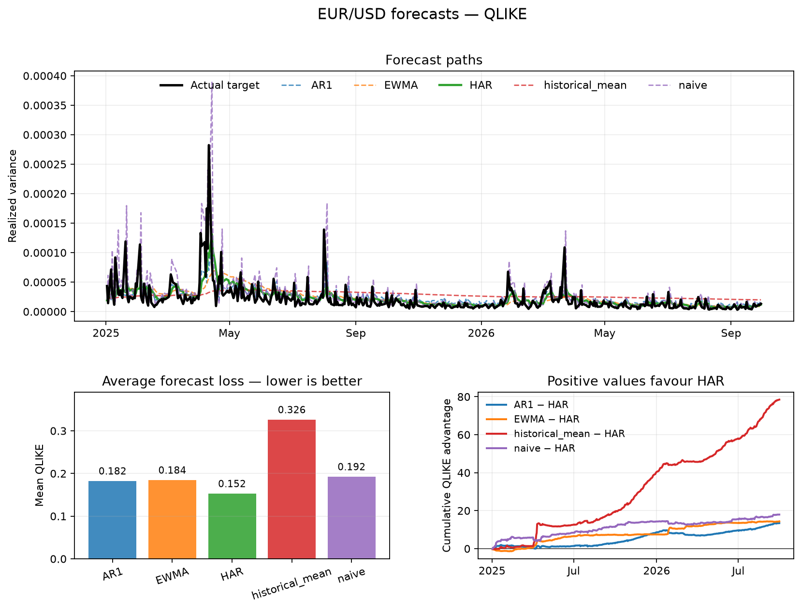

# Realized volatility forecasting: EUR/USD

How well can tomorrow's EUR/USD volatility be forecast from intraday data? This
project measures daily realized variance from tick quotes and compares five
forecasting models out of sample, walk-forward, with no look-ahead.

**Result:** the HAR model has the lowest loss under both metrics. It beats every
benchmark by 16–53% in QLIKE, and each difference is significant at the 1%
level (one-sided Diebold–Mariano test).

## Results

453 out-of-sample sessions, 2 January 2025 – 30 September 2026. Lower loss is
better.

| model | QLIKE | HAR lower by | DM p-value | log-RV MSE | DM p-value | HAR wins (QLIKE) |
|---|---|---|---|---|---|---|
| **HAR** | **0.152** | — | — | **0.265** | — | — |
| AR(1) | 0.182 | 16.3% | 2×10⁻⁵ | 0.310 | 1×10⁻⁴ | 61% of days |
| EWMA | 0.184 | 17.2% | 8×10⁻⁴ | 0.305 | 0.009 | 63% of days |
| naive (today = tomorrow) | 0.192 | 20.6% | 2×10⁻⁴ | 0.359 | 6×10⁻⁶ | 51% of days |
| historical mean | 0.326 | 53.2% | 2×10⁻¹¹ | 0.541 | 1×10⁻⁷ | 76% of days |



- **QLIKE is the headline metric.** RV is only a noisy estimate of the true
  variance. QLIKE still ranks forecasts correctly under that noise, while MSE
  on logarithms does not (Patton, 2011). Both metrics put HAR first and the
  historical mean last; AR(1) and EWMA swap places.
- **HAR wins by avoiding large misses, not by winning every day.** Against the
  naive forecast it wins only 51% of sessions but has a 21% lower mean QLIKE.
  The advantage accumulates across the whole sample rather than coming from a
  few days (lower-right panel above).
- **The conclusion does not depend on the HAC lag.** With 0–5 Newey–West lags,
  every QLIKE p-value stays below 0.001 and every log-MSE p-value below 0.01.

## Method

1. **Data.** Dukascopy EUR/USD tick quotes; price = bid/ask mid. A trading day
   is an FX session ending at 17:00 New York time; sessions shorter than 12
   hours (holidays, the Sunday open) are dropped. 973 sessions, January 2023 –
   October 2026.
2. **Realized variance.** The sum of squared 5-minute log returns within each
   session, using the last quote in each 5-minute bin. The signature plot in
   [EUR/USD research](docs/eurusd-research.md) shows why 5 minutes: finer
   sampling is inflated by bid–ask noise.
3. **Models**, all forecasting next-session log RV:
   - historical mean;
   - naive (today's value);
   - EWMA (decay 0.94);
   - AR(1) on today's log RV;
   - HAR (Corsi, 2009): regression on today's log RV and its 5- and 22-session
     means.
4. **Walk-forward.** Every model is refitted each session on an expanding
   window (at least 252 sessions), using only outcomes observed by that
   session's close.
5. **Back to variance.** exp(log forecast) is the median of RV, not its mean,
   so it forecasts too low. Each forecast is multiplied by a Duan smearing
   factor: the mean of exp(error) over that model's earlier errors observable at
   the forecast date. Forecasts from October–December 2024 only provide those
   errors.
6. **Evaluation.** QLIKE on variance forecasts and MSE on log forecasts. A
   one-sided Diebold–Mariano test of whether HAR has lower expected loss than
   each benchmark, with a Newey–West variance (5 lags).

## Limitations

- **One instrument, one period.** The result supports HAR on EUR/USD over
  2025–2026, not universally.
- **Nested models.** AR(1) is HAR without the weekly and monthly terms. For
  nested models the DM test is approximate and conservative (Clark & West,
  2007); at these p-values the conclusion is unaffected.
- **Fitting and scoring losses differ.** Models are fitted by least squares on
  logarithms but scored by QLIKE on variance. Smearing removes the resulting
  downward bias, but no model is fitted to minimise QLIKE.
- **Inspected period.** The period was not fixed in advance of all analysis.
  The archived Q1 2024 study in [EUR/USD research](docs/eurusd-research.md)
  froze its design before evaluation and also found HAR best under both
  metrics.

## Reproduce

```sh
pip install -e ".[dev,notebooks]"

# download tick quotes, one quarter per call (repeat for 2023-Q1 … 2026-Q3)
python -m rvol.data.sources.dukascopy EURUSD 2023-01-01 2023-03-31
```

Then run the notebooks in order, top to bottom:

| notebook | what it does |
|---|---|
| [`01_data`](notebooks/01_data.ipynb) | builds and audits the daily RV dataset; signature plot and noise test |
| [`02_simulation`](notebooks/02_simulation.ipynb) | checks the RV estimator on Heston paths with known integrated variance |
| [`03_forecasting`](notebooks/03_forecasting.ipynb) | walk-forward forecasts, evaluation, robustness; the results above |

The notebooks call the library for every calculation and own all
visualisation: each figure is drawn in its notebook and saved in `figures/`,
including the one above. Calculations live in `src/rvol` and are covered by
tests. Model list, dates and smearing settings are set at the top of
`03_forecasting`.

Data files live under `data/`, one folder per stage (not in git):

- `raw/dukascopy/EURUSD/`: downloaded hourly tick files, a cache that is never edited;
- `ticks/EURUSD/`: decoded bid/ask quotes, one Parquet file per quarter;
- `derived/`: the daily RV dataset that forecasting reads.

Dataset details and the archived Q1 2024 study are in
[EUR/USD research](docs/eurusd-research.md).

## Project layout

```text
src/rvol/
├── data/                    acquire, persist and prepare observations
│   ├── sources/dukascopy.py tick download, decoding and cache
│   ├── market/              FX sessions and timestamp sampling
│   ├── volatility/          daily RV dataset, coverage audit, log-RV features
│   ├── preparation.py       target construction and feature/target alignment
│   └── parquet.py           atomic Parquet storage
├── estimators/              realized variance, per-session RV, sampling-frequency diagnostics
├── models/                  historical mean, naive, EWMA, AR(1), HAR, OLS
├── backtesting/             walk-forward planning and execution
├── evaluation/              losses, DM test, robustness, variance conversion
├── experiment.py            the study: prepare, forecast, compare, results table
└── simulation/              Heston paths, observation noise, Monte Carlo validation
notebooks/                   01_data, 02_simulation, 03_forecasting
tests/
```

Dependencies point one way: `models` ← `backtesting` ← `evaluation` ←
`experiment`. Data acquisition and preparation are independent of the
forecasting packages; the daily dataset builds on `estimators`, and
`simulation` depends on nothing else in the package. Notebooks connect the
pieces and draw every figure. `tests/test_architecture.py` enforces these
directions.

- **Models** receive numerical arrays only; they never choose columns, build
  targets or transform units. A configured model fits arrays and returns a
  fitted predictor.
- **Walk-forward is split in two.** `WalkForwardPlanner` decides when to refit
  and which rows are observable. `WalkForwardRunner` executes that plan.
- **Evaluation** consumes forecast tables; it never sees models or market data.
- **The library draws nothing.** It returns numbers and tables (including the
  running RV, running IV and cumulative loss advantage behind each figure);
  matplotlib is only needed for the notebooks.

## Using the library

### Walk-forward on a prepared table

A prepared table has one row per forecast origin:

| column | meaning |
|---|---|
| origin_date | when the inputs are known |
| target_date | when the outcome is observed |
| target | the outcome, in the caller's scale |
| other columns | numerical inputs, selected by name |

Origins and targets must be unique, every origin must precede its target, and
inputs must use only information available at the origin.

```python
from rvol.backtesting import WalkForwardPlanner, WalkForwardRunner
from rvol.evaluation import MSEMetric, evaluate
from rvol.models import HARModel

runner = WalkForwardRunner(
    WalkForwardPlanner(window="expanding", min_train_size=252, refit_every=1)
)
forecasts = runner.run(
    prepared,
    model=HARModel(),
    feature_columns=("log_rv_daily", "log_rv_weekly", "log_rv_monthly"),
)
evaluation = evaluate(forecasts, metrics=(MSEMetric(),))
```

Planner settings:

- `window="rolling"` with `window_size` uses a rolling window instead of an
  expanding one.
- `forecast_start` and `forecast_end` are inclusive target-date bounds. They
  keep earlier history for training and keep the refit schedule.
- Only labels with `target_date <= origin_date` enter training.

`runner.plan(prepared).execution` returns the settings and the actual refit
anchor, so a notebook can record exactly how forecasts were produced.

Forecast tables have these columns: model, origin_date, target_date, actual,
predicted, n_train, fit_date, train_start_date, train_end_date, run_id and
fold_id. `evaluate` requires one run and identical dates and actual values
across the models it compares.

### Adding a model

A model needs a `name` and `fit(X, y)` returning an object with `predict(X)`. No
base class or registration is required:

```python
import numpy as np

from rvol.models import ConstantPredictor


class MedianModel:
    name = "median"

    def fit(self, features, target):
        return ConstantPredictor(float(np.median(target)), n_features=features.shape[1])
```

A predictor may also implement `update(X, y)`, returning new state after newly
observable outcomes between refits; EWMA uses this.

## Install and check

```sh
python -m venv .venv
source .venv/bin/activate
pip install -e ".[dev]"
pytest -m "not slow"
ruff check src tests notebooks
mypy src tests
```
